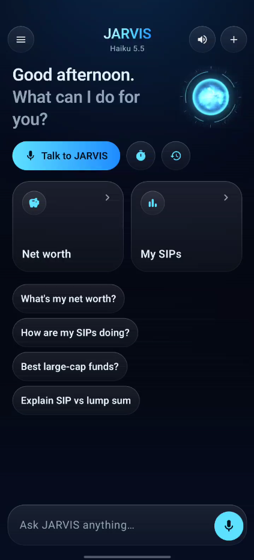
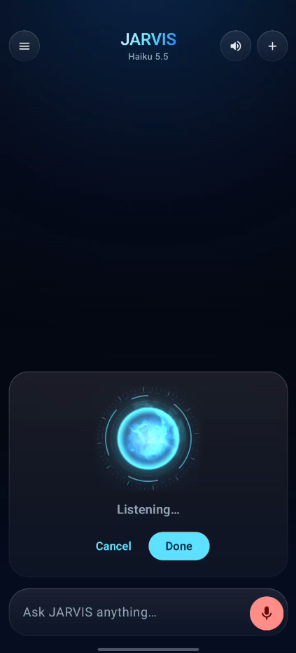

# JARVIS for Android

A hands-free personal AI assistant for Android, powered by Claude. It runs on the phone only, with no backend
server. You bring your own Anthropic API key.

> **Status: Phase 5 ("Hey Jarvis" wake word).** Say "Hey Jarvis" with the phone on the table, locked or in your
> pocket, and have a spoken conversation with Claude. You can also chat by text. JARVIS can answer questions about
> your INDmoney portfolio ("what's my net worth?") through INDmoney's MCP server, after a spoken PIN or your
> fingerprint. Riding mode comes next. See [PROGRESS.md](PROGRESS.md) and the phase plan in [CLAUDE.md](CLAUDE.md).

## Screenshots
<p align="center">
  
  &nbsp;&nbsp;
  
</p>

## Features in this build
- **"Hey Jarvis", hands-free:**
  - A small always-on wake model listens on the phone: no sounds, low battery, and no audio leaves the phone.
  - The screen reacts at once: a full-screen black HUD with an animated arc-reactor orb, even over the lock screen.
  - You can ask in one breath: "Hey Jarvis, what's the time?"
  - Conversations continue until you say "thanks" or stay quiet for 15 seconds.
  - In a pocket, JARVIS talks through your Bluetooth headset with the screen off.
- **Teach JARVIS your voice:** a 2-minute on-phone training so it catches your accent and ignores conversation.
  When it wakes by mistake, tap "Not for me" and it learns from that.
- **Voice everywhere:** push-to-talk in chat, spoken replies sentence by sentence, barge-in, quiet mode, and a
  customisable wake sound.
- **Spoken PIN:** say your PIN when the phone is locked or in a pocket. It's recognised on the phone.
- **Instant answers:** the time, date and battery are answered on the phone, with no API call.
- JARVIS HUD design: always dark, arc-reactor blue, frosted-glass cards.
- Chat screen with streaming replies, a Stop button and plain-language errors with a fix button.
- Secure settings. The Anthropic key and connector tokens are encrypted with the Android Keystore.
- **Your own data, private by default (D29):** Claude understands the question in any wording and hands it back to
  the phone, which reads your data and answers. Nothing personal goes to Anthropic unless you allow it per feature.
  - **INDmoney:** net worth, bank (Liquid), holdings, SIPs, card dues. Your token and numbers never go to Anthropic.
    Jargon like "where am I bleeding money?" works: Claude writes the answer from the data's outline and the phone
    fills in the figures (D32).
  - **Gmail (read-only):** what needs attention first (bills with amount and due date, people, jobs, government,
    security), newsletters and social only counted; search by sender or topic.
  - **Calendar:** today, next meeting, when something is (the calendar your phone already syncs).
  - **Google Drive:** find a file by name, recent files (names and dates only).
  - **Calls:** who called, missed calls, last call with someone; search what was said in calls your dialer
    recorded (transcribed on the phone).
  - **Messages:** texts and WhatsApp/Telegram/Signal messages; send an SMS or reply to a chat after you confirm
    the full text ("send it"), with 5 seconds to cancel and a log of every send.
  - **Email by voice (optional):** "email Priya about Friday", "reply to Priya's email: I'll join at 3"; replies
    stay in the same Gmail thread. Same confirmation as SMS. Needs the send-only Google grant (Settings → Gmail).
  - **Calls by voice:** "call Mom" (also hands-free with "Hey Jarvis"); JARVIS says who and which number and calls
    when you say "call". New WhatsApp messages to any contact open WhatsApp with the text typed; you tap send.
  - **Other app notifications (optional):** "what did I miss?", "notifications from Amazon" (bank alerts,
    deliveries, reminders; off by default, kept 3 days, one-time codes skipped).
  - **Privacy controls:** Private mode, and per-feature consent to send a redacted version to Claude for summaries.
- Cost control:
  - only the relevant tools are sent per request
  - Claude Haiku 5.5 by default, the cheapest model (Sonnet 5.5 is optional in Settings)
  - short replies by default, thinking off for simple questions, small output caps
  - only the last few turns are resent, and long ones are clipped
  - prompt caching
- Usage screen showing tokens, estimated cost and latency per request. The monthly budget defaults to $5: it warns
  at 80% and stops requests when used up (both configurable).
- A first-launch setup wizard (Anthropic key, connectors).
- Chat history on the phone: searchable, deletable one by one or all at once.
- Saved portfolio data: reused for 15 minutes (configurable) to save a connector call, always labelled
  "updated 10:42" or "saved data from 10:30". Say "refresh" to fetch it live.
- Audit log of requests, tool calls, sign-in and security events (no message content), kept 180 days.
- Copy a reply, a message, or the whole chat.
- Security:
  - with the phone unlocked, private answers need no extra PIN (a setting); when it's locked or in a pocket,
    sensitive answers ask "PIN or fingerprint?"
  - fingerprint answers are shown on screen only
  - 3 wrong PINs lock the PIN until a fingerprint unlocks it
  - short sessions that end when the screen turns off or you type "lock"
  - per-tool Allow / Ask / Deny

## Setup
1. Install the app: see [docs/install.md](docs/install.md).
2. Open it. The wizard asks for your Anthropic API key and tests it. **Set a monthly spend limit on your
   Anthropic key** in the Anthropic Console.
3. Optional: sign in to INDmoney, Gmail and Drive (see [docs/setup-keys.md](docs/setup-keys.md)), and allow the
   phone data you want in Settings → Phone data.

## Permissions
| Permission | Why |
|---|---|
| Internet | To call the Anthropic API and connector sign-in/refresh endpoints. |
| Microphone | Push-to-talk: JARVIS listens only after you tap the mic. Speech is recognised on the phone when supported. |
| Foreground service (microphone) | "Hey Jarvis": listens on the phone for the wake word while the notification shows. Off by default. |
| Display over other apps (optional) | Lets the "Hey Jarvis" screen pop up over other apps and the lock screen. |
| Battery optimisation exemption (optional) | Stops battery savers from killing the wake-word listener. |
| Modify audio settings | Routes pocket conversations through your Bluetooth headset. |
| Default digital assistant (optional, you choose it in Android Settings) | Keeps "Hey Jarvis" working any time, even after a restart, with no taps. |
| Wake model (download, 3.7 MB) | The "hey jarvis" detector (openWakeWord; models are CC BY-NC-SA 4.0, free for personal, non-commercial use). |
| Spoken PIN models (optional download, ~70 MB) | Digit recognition for the spoken PIN and call-recording transcripts, entirely on the phone. |
| Calendar (optional) | Today's events and your next meeting. Read-only. |
| Call log (optional, restricted*) | Who called, missed calls, last call with someone. |
| SMS and contacts (optional, restricted*) | Read your texts; send an SMS only after you confirm the full text; contact names. |
| Phone calls (optional) | "Call Mom": place the call after you confirm. Without it, JARVIS opens the dialer with the number. |
| Notification access (optional, restricted*) | Read WhatsApp/Telegram/other chat messages and reply through their own reply button. With "Other app notifications" on (off by default), also keeps other apps' notifications (bank alerts, deliveries) for 3 days so you can ask "what did I miss?". |
| A folder you pick (optional) | Your dialer's call-recordings folder, read-only, for on-phone transcripts. JARVIS never records calls. |

\*Android restricts these for apps installed from a downloaded file: if it refuses, open App info → ⋮ → **Allow
restricted settings**, then allow again.
| Run at startup | Only posts a "tap to resume listening" notification after a reboot. |
| Notifications (Android 13+, optional) | Only to alert you if your JARVIS PIN gets locked. Asked when you set a PIN. |
| Biometrics (no permission prompt) | Fingerprint or screen lock for sensitive answers, through Android's own prompt. |

Each is asked for in Settings → Phone data, with a one-line reason.

## Privacy and security
- No analytics or telemetry. Usage stats, chat history, saved data and the audit log stay on the phone and are
  excluded from backups.
- Your questions are sent to Anthropic's API so Claude can understand them. Personal data (portfolio, email,
  calendar, files, calls, messages) is read and answered on the phone and isn't sent to Anthropic, nor are
  connector tokens (D29), unless you allow a feature in Settings → Privacy, and then only a redacted version.
- Secrets never go in the repo, logs or backups. See [docs/security.md](docs/security.md).

## Building
Requires JDK 17 and the Android SDK (platform 37.2, build-tools 36).
```
gradlew testDebugUnitTest   # unit tests
gradlew assembleDebug       # app/build/outputs/apk/debug/app-debug.apk
```
CI (GitHub Actions) runs the unit tests, builds the APK and runs a gitleaks secret scan.

## Docs
- [Architecture](docs/architecture.md)
- [Decisions](docs/decisions.md)
- [Security](docs/security.md)
- [Keys and connectors setup](docs/setup-keys.md)
- [Install](docs/install.md)

## Credits
- Wake word: [openWakeWord](https://github.com/dscripka/openWakeWord) by David Scripka. The code is Apache-2.0; the
  pre-trained models are CC BY-NC-SA 4.0 and are downloaded by the app, not included here.
- On-device speech: [sherpa-onnx](https://github.com/k2-fsa/sherpa-onnx) (Apache-2.0), Moonshine (MIT), 3D-Speaker
  ERes2Net (Apache-2.0). TensorFlow Lite runtime: [LiteRT](https://ai.google.dev/edge/litert) (Apache-2.0).

## Licence
Not chosen yet (see PROGRESS.md open questions). The wake model's non-commercial licence applies to the downloaded
models, not to this code.
